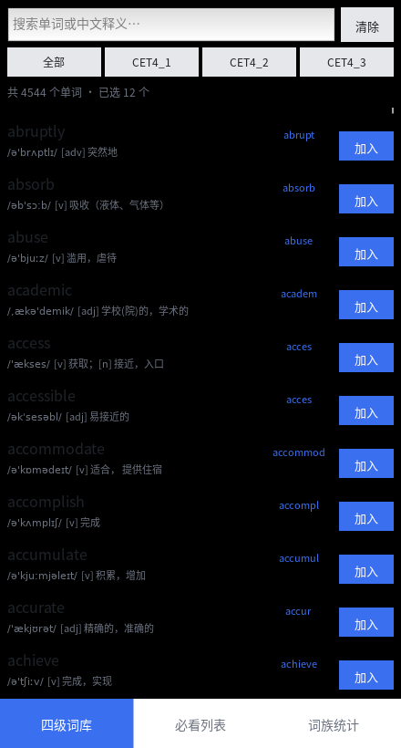
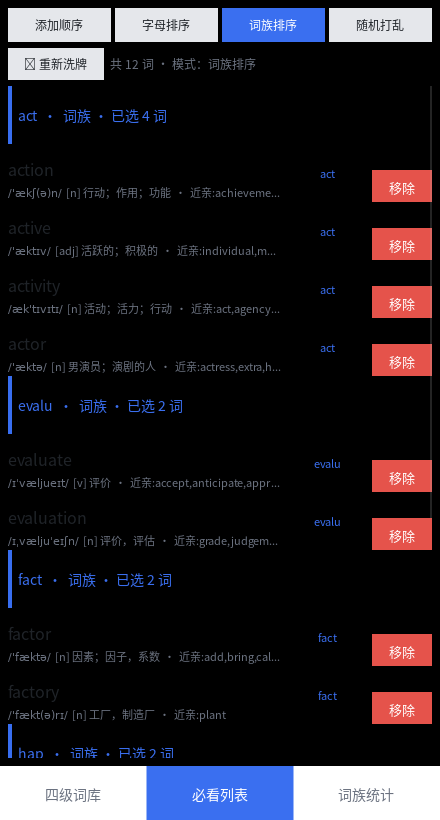
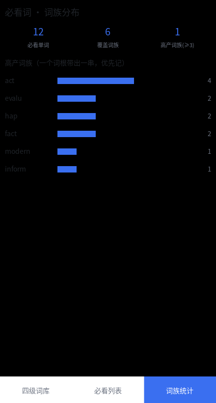

# 看单词 App（安卓版，纯 Python / Kivy）

一个装在手机上的四级背单词工具：内置 **4544 个 CET-4 单词**（音标 / 词性 / 中文释义 / 例句 / 真题例句），
从词库里挑词进「必看列表」，列表支持 **4 种排序**，并按 **词典级词族** 做分类汇总。

<p align="center">
  
  
  
</p>

## 功能

### 1. 四级词库
- 4544 个四级词，按教材单元分册（CET4_1 / CET4_2 / CET4_3）
- 支持按英文单词或中文释义搜索
- 每条显示：单词 / 音标 / 词性 / 释义 / 所属词族
- 一点「加入」即进必看列表，并记录加入日期（今天新选的排在列表后面）

### 2. 必看列表（4 种排序）
| 模式 | 说明 |
|---|---|
| 添加顺序 | 每日新选的单词自动排在一列表**后面**（按加入日期分组，同日保持录入顺序） |
| 字母排序 | A→Z |
| 词族排序 | 按词典词族归类，每族一个标题，标注该族已选几个词 |
| 随机打乱 | 一键洗牌，防止靠位置记单词 |

### 3. 词族统计
- 必看词总数、覆盖词族数、高产词族数（≥3 词的族）
- 词族分布排行：一眼看出「一个词根带出一串」的高价值词族

### 4. 词典级词族库
- 词族数据来自 **WordNet 3.0**（Princeton）派生关系（`@` derivationally related form）
- 覆盖全部 4544 个四级词，划出 **3558 个词族**（其中 651 个为多词族）
- 样例：`act` 族 = act / actor / action / active / actual / actress / activity / actually；
  `evalu` 族 = evaluate / evaluation；`hap` 族 = happy / happiness；`fact` 族 = fact / factor / factory
- 每个词还带 **词典派生近亲**（WordNet 直接派生关系），显示在释义右侧

## 目录结构

```
cet4_vocab_app/
├── main.py                     # Kivy 主程序（界面 + 逻辑）
├── data/
│   ├── cet4.json               # 四级词库（1.1 MB）
│   └── families.json           # 词族库 + 近亲映射（0.6 MB）
├── assets/fonts/
│   ├── NotoSansSC-Regular.otf  # 中文字体（Kivy 默认 Roboto 不含汉字，必须自带）
│   └── DejaVuSans.ttf          # 音标字体（IPA 字符 ˈ æ ʃ ə 只有它有）
├── tools/build_data.py         # 重新生成 data/ 下的 JSON（仅标准库）
├── tests/smoke_test.py         # 冒烟测试：数据/排序/词族/界面构建
├── buildozer.spec              # APK 打包配置
├── requirements.txt
└── .github/workflows/build-apk.yml   # 云端打包 APK
```

## 本地预览（电脑先跑起来看看）

```bash
pip install kivy
python main.py
python tests/smoke_test.py     # 跑一遍自检
```

桌面会按 440×820 的手机尺寸显示。

## 打包成安卓 APK

Buildozer 只能在 Linux 上跑，Windows 用户有两条路：

**A. GitHub Actions 云端打包（推荐，Windows 上零配置）**
1. 把整个目录推到 GitHub 仓库
2. 打开仓库的 Actions → `Build Android APK` → Run workflow
3. 打包完成后在 Artifacts 里下载 `vocab-apk`（内含 `.apk`）
4. 传到手机安装（需允许"安装未知来源应用"）

**B. 本地 WSL2 打包**
```bash
sudo apt-get install -y git zip unzip openjdk-17-jdk python3-pip autoconf libtool pkg-config zlib1g-dev cmake libffi-dev
pip install buildozer
python -m buildozer android debug
# 产物在 bin/ 目录
```

## 重新生成词库数据

`tools/build_data.py` 只依赖标准库。输入：
- CET-4 词汇本 JSONL（kajweb/dict 导出的 `CET4_*.json`）
- WordNet 数据库（nltk_data 的 `corpora/wordnet.zip`）

```bash
python tools/build_data.py --cet4-dir <CET4目录> --wordnet-zip <wordnet.zip>
```

> 说明：WordNet 的派生关系在完整词库上是一张**全连通大图**，直接求传递闭包会把几乎所有单词并成一族
> （实测 act / action / a 全混在一起，3426/4544 词塌成一族）。因此这里只在**四级词集合内部**建派生图，
> 再配合词干归一（剥离派生后缀）+ 链式归一（factory→factor→fact），得到教材意义上的词族。

## 踩坑记录（Kivy 相关，改代码前值得看一眼）

1. **`viewclass` 必须传类，且必须挂在 `RecycleBoxLayout` 上**
   `RecycleView(viewclass="RowItem")` 在构造时 layout_manager 还不存在，赋值会被静默丢弃 → 列表永远空白。
   正确写法：`RecycleBoxLayout(..., viewclass=RowItem)`（传字符串也不会被解析）。
2. **layout manager 高度必须等于内容总高**
   否则 viewport 只有 100px，列表既不滚动也只显示一两行。
   解决：`_sync_rv_height(rv)` 把 `rv.layout_manager.height` 设为 `len(data) * 行高`。
3. **`halign` 必须配 `text_size` 才生效**
   没设 `text_size` 时 Kivy 把文字居中显示。`mk_label()` 已统一绑定。
4. **中文字体要自带**：Kivy 默认 Roboto 不含汉字；IPA 音标字符 Noto Sans SC 也没有，
   所以中文字体与音标字体分两个，用 markup `[font=IPA]...[/font]` 混排。
5. **选择数据持久化在 `App.user_data_dir/selection.json`**，卸载重装才会清空；测试时记得先清空。

## 数据来源

- 四级词库：kajweb/dict（CET4_1/2/3 词汇书导出）
- 词族库：Princeton WordNet 3.0（nltk_data 分发）
- 字体：Noto Sans SC（SIL Open Font License）、DejaVu Sans（Bitstream Vera / Public Domain）
